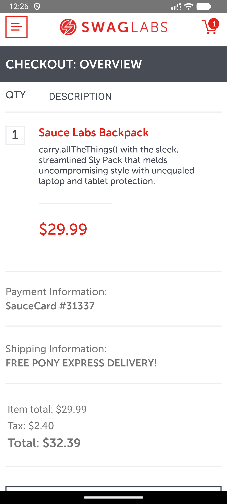

# Mobile Automation with Appium

[](https://github.com/WasAsh/MobileAppAutomation-Appium/actions/workflows/android.yml)

Android end-to-end tests for the [Sauce Labs Swag Labs sample app](https://github.com/saucelabs/sample-app-mobile),
built with **WebdriverIO 9 + Appium 3 + TypeScript**, Page Object Model, Allure reporting,
tagged smoke/regression suites, and GitHub Actions CI on an API 34 emulator.

## Test coverage

| Spec | Covers | Tests |
|---|---|---|
| `smoke.spec.ts` (`@smoke`) | App launches to the login screen | 1 |
| `add-to-cart.spec.ts` (`@regression`) | `standard_user` login → PRODUCTS → first product → cart shows product name | 1 |
| `remove-from-cart.spec.ts` (`@regression`) | Add first product → remove → cart empty (`REMOVE` node gone) | 1 |
| `problem-user.spec.ts` (`@regression`) | `problem_user` logs in and shops like `standard_user` (its broken-images quirk is visual-only — see spec comment) | 1 |
| `checkout.spec.ts` (`@regression`) | Add → cart → info (`John`/`Doe`/`12345`) → overview → `CHECKOUT: COMPLETE!` | 1 |
| `login-negative.spec.ts` (`@regression`) | Locked-out, invalid credentials, empty username, empty password — exact error strings | 4 |

6 spec files / 9 tests. Happy-path specs isolate state with
`beforeEach(browser.reloadSession())`; product lookups scope to the first
`test-Item` container (sort-order safe); checkout scrolls `test-FINISH` into
view via the `BasePage.scrollToElement` helper.

## Prerequisites

- Node.js 24, pnpm 11.21.0
- Java 17+, Android SDK (`platform-tools` + an emulator, e.g. Pixel, API 34+)
- A booted emulator with the Swag Labs app **v2.3.0** installed, or point
  `ANDROID_APP_PATH` at the APK ([release asset](https://github.com/saucelabs/sample-app-mobile/releases/download/2.3.0/Android.SauceLabs.Mobile.Sample.app.2.3.0.apk))
- No global Appium install needed: Appium 3 and the UiAutomator2 driver are
  project-local devDependencies; `postinstall` registers the driver automatically

## Setup

```bash
pnpm install
cp .env.example .env   # then fill in local values; never commit .env
```

`.env` keys (`ANDROID_DEVICE_NAME`, `ANDROID_PLATFORM_VERSION`,
`ANDROID_APP_PATH`, `APPIUM_PORT` — see `.env.example` for local defaults).
Without `ANDROID_APP_PATH`, the suite drives the installed
`com.swaglabsmobileapp` / `.MainActivity` instead of installing the APK.

Boot the emulator before running, e.g.:

```bash
emulator -avd <your_avd> -no-snapshot -gpu swiftshader_indirect -noaudio
adb wait-for-device
```

## Run

```bash
pnpm test                # full suite (default WDIO specs glob)
pnpm test:android         # same as pnpm test
pnpm test:smoke          # @smoke suite only
pnpm test:regression     # @regression suites only
pnpm test:all            # full suite (explicit, used by CI)
pnpm exec tsc --noEmit   # typecheck (also a CI gate)
```

## Allure report

Each run writes raw results to `reports/allure-results` (plus failure
screenshots auto-attached by the `afterTest` hook and the Appium server log at
`reports/wdio-appium.log`). The run environment (device/app/port) is recorded
in the report via `reportedEnvironmentVars`. `reports/` is gitignored.

Generating the HTML report needs the external `allure` CLI (intentionally not
a project dependency — no Java/JDK version coupling in `package.json`):

```bash
npm install -g allure-commandline   # or: scoop install allure (Windows)
pnpm report:allure                  # generate reports/allure-report
allure open reports/allure-report   # view in a browser
```

CI uploads the raw `reports/` directory as the `test-results` artifact
(14-day retention, even on failure); publishing a viewable HTML report from CI
is tracked as the deferred T7 step in `Docs/next-phase-plan.md`.

## Screenshots



CHECKOUT: OVERVIEW screen (Sauce Labs Backpack, $29.99 order summary),
captured automatically by the suite's `afterTest` failure-screenshot hook
during a checkout run. Strategy and scope: `Docs/test-strategy.md`.

## Conventions

- Page objects in `test/pageobjects` (`BasePage`: wait/tap/type/scroll;
  `LoginPage`, `ProductsPage`, `CartPage`, `CheckoutPage`); demo users and
  `checkoutInfo` in `test/data/users.ts` (public `secret_sauce` demo credentials).
- Suites carry Mocha title tags (`@smoke`, `@regression`), mirrored by WDIO
  `suites` in `wdio.conf.ts` for `--suite` selection; each spec is labelled
  with an Allure feature (`Smoke`, `Shopping cart`, `Checkout`,
  `Authentication`) via the `beforeTest` hook.
- Prefer accessibility-id selectors over `UiSelector().text()`.
- CI (`.github/workflows/android.yml`, push + PR): pnpm 11.21.0, Node.js 24,
  Java 17 (Temurin), API 34 emulator (`google_apis`/`x86_64`/`pixel_2`, KVM
  enabled), pinned Swag Labs 2.3.0 APK download, `tsc` gate, `pnpm test:all`,
  `reports/` artifact on always.

## Layout

```text
test/pageobjects   Base + Login / Products / Cart / Checkout page objects
test/data          demo users (standard, locked-out, problem, invalid) + checkoutInfo
test/specs         smoke, add-to-cart, remove-from-cart, problem-user, checkout, login-negative
scripts/           postinstall: register pnpm-installed UiAutomator2 driver
wdio.conf.ts       caps, suites, reporters, Allure hooks (env-driven, no secrets)
Docs/              next-phase-plan.md (sequential tasks T1–T8), test-strategy.md, assets/
.github/workflows  Android E2E CI
```
